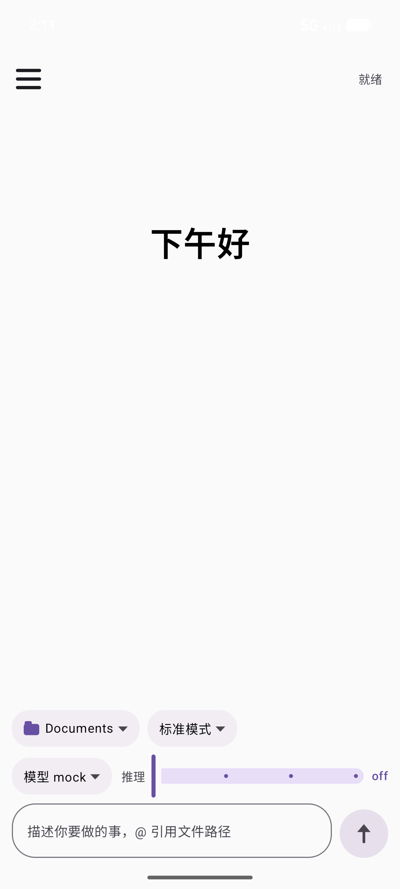
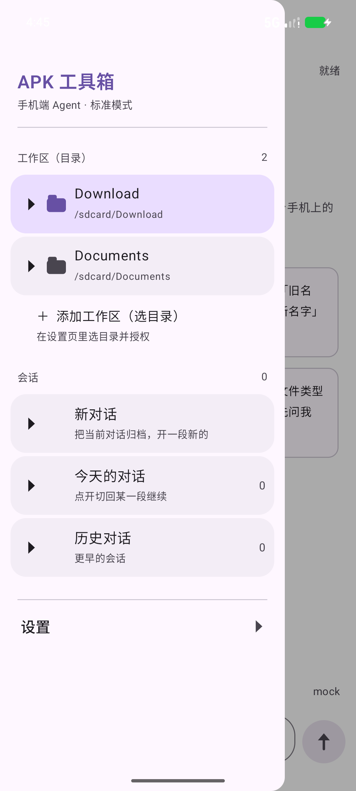
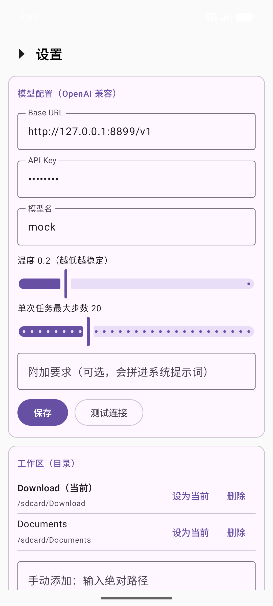
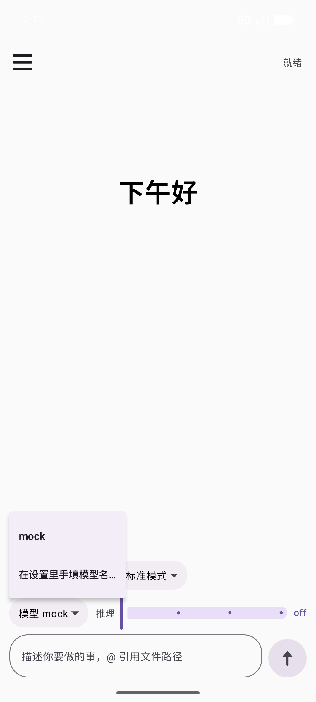
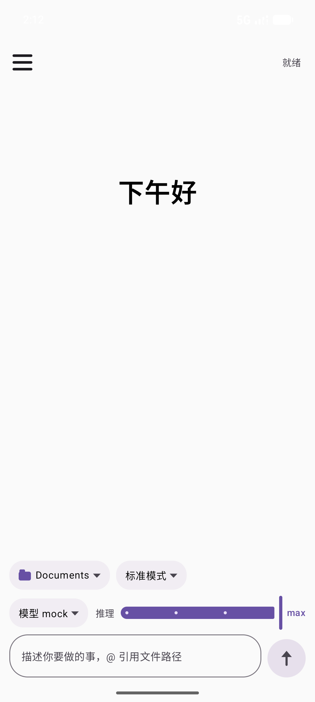
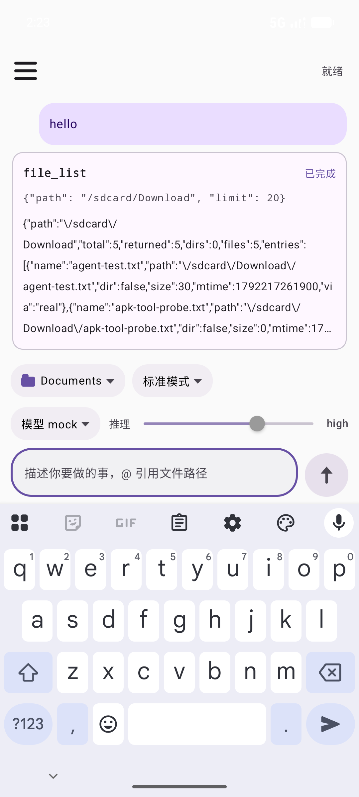
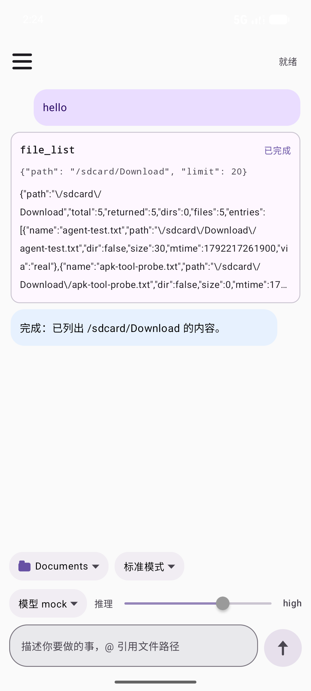

# 1Z-Agent · 手机端 AI Agent

> 一个跑在 Android 手机上的单机 AI Agent：填一个 OpenAI 兼容的 API，模型就能自己规划、调用 22 个本地工具，直接读写这台手机里的文件和安装包。
>
> An on-device AI agent for Android: point it at any OpenAI-compatible API and the model plans and calls 22 local tools to read, write and analyse files and APKs **on the phone itself**.

<p align="center">
  
  
  
</p>

---

## 一、这是什么东西 / What is this

**中文**

1Z-Agent 不是一个「聊天 App」套壳。它是一个**真正的 Agent 运行时**：

- 你在输入框说一句话（「把 Download 里所有 APK 的包名列出来」「把这个文件里的旧名字全改成新名字」）；
- App 把这句话，加上 22 个工具的 JSON Schema，发给**你配置的** OpenAI 兼容模型；
- 模型返回 `tool_calls`，App 在本机执行（读目录、解析 APK、改文本……），把结果回灌给模型；
- 模型继续下一步，直到任务完成 —— 最多 N 步（默认 20），每一步都可中断。

**没有任何中间服务器**。手机直连你自己填的 `Base URL`；密钥只存在本机 `SharedPreferences` 里；对话记录只落在 App 私有目录。

**English**

1Z-Agent is not a chat wrapper — it is a real agent runtime:

- you say one sentence ("list the package names of every APK in Download", "rename the old string in this file");
- the app sends it, together with JSON Schemas for 22 tools, to the OpenAI-compatible model you configure;
- the model answers with `tool_calls`; the app runs them locally (list dirs, parse APKs, edit text …) and feeds results back;
- the loop continues until the task is done — at most N steps (default 20), interruptible at any moment.

**No middle server.** The phone talks directly to the `Base URL` you enter; the API key lives only in on-device `SharedPreferences`; conversations stay in the app's private storage.

---

## 二、界面 / Screens

| 首页 / Home | 模型选择 / Model picker | 推理等级 / Reasoning effort |
|---|---|---|
|  |  |  |

| 键盘弹起时输入栏贴键盘 / Input above keyboard | 三类气泡 / Three bubble types |
|---|---|
|  |  |

对话区用颜色区分来源：**淡紫 = 你说的话**，**浅蓝 = Agent 说的话**，**白底描边卡 = 工具调用**（含参数与返回值）。

The conversation area is colour-coded: **lilac = you**, **light blue = the agent**, **outlined card = a tool call** (arguments and result shown inline).

---

## 三、22 个内置工具 / The 22 built-in tools

| 工具 / Tool | 说明 / What it does |
|---|---|
| `storage_status` | 报告存储访问模式：是否已授予「所有文件访问权限」、已授权的 SAF 目录、App 私有目录位置。/ Reports storage access mode. |
| `file_list` | 列目录，返回 `name/path/dir/size/mtime/via`（`via=real` 真实路径、`via=saf` SAF 回退）。/ List a directory. |
| `file_stat` | 单个文件/目录的元数据，`hash=true` 时附带 SHA-256。/ Metadata of one path, optional SHA-256. |
| `file_read_text` | 读文本（UTF-8），默认最多 256 KiB。/ Read text, 256 KiB by default. |
| `file_read_bytes` | 按偏移读原始字节，返回 base64（看文件头/魔数）。/ Read raw bytes as base64. |
| `file_search` | 按名字递归搜索（大小写不敏感子串）。/ Recursive name search. |
| `file_write_text` | 写文本，父目录自动创建，`append` 可追加。/ Write text, auto-mkdir, append mode. |
| `file_mkdir` | 创建多级目录。/ Create directories. |
| `file_delete` | 删除文件/目录，非空目录需显式 `recursive=true`。/ Delete, recursive must be explicit. |
| `file_copy` | 复制文件（真实路径与 SAF 目录互拷）。/ Copy, including real↔SAF. |
| `file_move` | 移动/改名（同盘 rename，跨盘复制后删）。/ Move or rename. |
| `text_grep` | 字符串/正则搜索文本，返回行号与行内容。/ Grep with line numbers. |
| `text_replace` | 字符串/正则替换，返回 diff，`preview=true` 只预览。/ Replace with diff, dry-run supported. |
| `text_stat` | 统计行数、字符数、结尾是否换行。/ Line/char counts, trailing newline. |
| `apk_info` | 包名/版本/SDK/权限/四大组件/签名摘要。/ Package, version, SDK, permissions, components, signature digest. |
| `apk_entries` | APK 内部 ZIP 条目列表，可按名过滤。/ ZIP entries inside the APK. |
| `apk_manifest` | 把二进制 AXML 的 `AndroidManifest.xml` 解码成文本。/ Decode binary AXML manifest to text. |
| `apk_dex_classes` | 列出所有 dex 里的类（父类 + 访问标志），可按名过滤。/ List classes across all dex files. |
| `apk_dex_class` | 单个类的结构：字段、方法签名（不反编译方法体）。/ One class: fields and method signatures. |
| `apk_resources` | 解析 `resources.arsc`：总览或按 `type` 展开条目。/ Parse `resources.arsc` overview or by type. |
| `apk_signature` | 检查 v1/v2/v3/SourceStamp 签名方案与 Signing Block。/ Signature schemes and signing block. |
| `agent_run` | 把一句话再交给手机上的 Agent 去做（可嵌套的自我调用）。/ Hand a sub-task back to the on-device agent. |

全部 22 个工具**同时**通过 MCP 暴露给 PC 端（见第六节）。/ All 22 tools are also exposed over MCP for desktop clients (see §6).

---

## 四、快速开始 / Quick start

### 1. 装包 / Install

```bash
adb install -r release/1Z-Agent-v1.0.apk
```

或把 `release/1Z-Agent-v1.0.apk` 传到手机点击安装（需允许「安装未知来源应用」）。
Or copy the APK to the phone and install it (allow "install unknown apps").

- 包名 / Package: `com.example.apktool`
- 最低 / Min: Android 8.0 (API 26) · 目标 / Target: Android 17 (API 37)
- 体积 / Size: 12.5 MB · 除 AndroidX 外无第三方运行时依赖 / no third-party runtime deps beyond AndroidX

### 2. 给文件权限 / Grant file access

首次让 Agent 动 `/sdcard` 前，去「设置 → 文件访问 → 打开系统授权页」，给 **所有文件访问权限**（`MANAGE_EXTERNAL_STORAGE`）。不给也能用，但只能碰 App 私有目录和通过 SAF 授权的目录。

Before the agent touches `/sdcard`, open **Settings → 文件访问 → 打开系统授权页** and grant **All files access** (`MANAGE_EXTERNAL_STORAGE`). Without it only the app-private directory and SAF-granted trees are reachable.

### 3. 配模型 / Configure the model

「设置 → 模型配置（OpenAI 兼容）」四个字段：

| 字段 / Field | 例子 / Example | 说明 / Notes |
|---|---|---|
| Base URL | `https://api.deepseek.com/v1` | 任何 OpenAI 兼容网关；**必须支持 function calling / tool_calls** |
| API Key | `sk-…` | 只存本机；以明文写入 App 私有 `SharedPreferences` |
| 模型名 / Model | `deepseek-chat` | 首页下拉可直接从 `/v1/models` 拉取列表 |
| 温度 / Temperature | `0.2` | 越低越稳定 |

填完点「测试连接」会真的发一次极小请求验证；通了再回首页发话。
Press **测试连接 / Test** to validate with one tiny request, then go back and start working.

> 常见可用的网关 / Common gateways: DeepSeek、OpenAI、Moonshot、阿里云百炼（DashScope 兼容模式）、火山方舟、本地 vLLM / Ollama（`http://<lan-ip>:11434/v1`）。
> 明文 `http://` 只默认放行 `127.0.0.1` 与 `localhost`，其它域名要自己在 `res/xml/network_security_config.xml` 里加。

---

## 五、怎么用 / How to use

### 一次完整任务 / One full task

1. 首页输入框说人话 → 点发送；
2. 状态栏显示「第 N 步 · …」；
3. 需要改动数据时弹出确认框：**执行 / 拒绝**，可勾「本次任务内不再询问」；
4. 工具卡上能看到参数与返回值；
5. 完成后状态变「完成（N 步）」，随时可以「停止」。

1. Type a sentence, press send.
2. The status bar shows "step N …".
3. Destructive actions raise a confirmation dialog — **Execute / Reject**, with a "don't ask again this task" checkbox.
4. Each tool card shows its arguments and result.
5. When done the status reads "完成（N 步）"; you can stop at any time.

### 三档权限模式 / Three approval modes

| 模式 / Mode | 行为 / Behaviour |
|---|---|
| 标准模式 / Standard | 每次改写或删除数据前弹窗确认（默认）/ confirm every mutating call |
| 自动执行 / Auto | 本次任务内全部放行 / approve everything for this task |
| 只读模式 / Read-only | 禁止一切改写操作，工具直接回「已阻止改写操作」/ block every mutating call |

### 四档推理等级 / Four reasoning levels

`off / low / high / max` —— 滑块选，落到请求里的 `reasoning_effort`：

| 档位 | 请求 / Request |
|---|---|
| off | 不传该字段（兼容性最好）/ field omitted |
| low / high | `reasoning_effort = "low"` / `"high"` |
| max | `high` + 提示词要求「结论前自检：路径存在？幂等？要不要问用户？」 |

### 工作区 / Workspaces

抽屉里「工作区（目录）」是**目录级**的上下文：选中哪条，系统提示词里就带上「当前工作区 = /sdcard/Download」，Agent 的相对路径都相对它解析。可加多个（下载、文档、SD 卡、任意 SAF 授权目录），抽屉里点一下就切。

Workspaces are directory-scoped contexts: the selected one is injected into the system prompt ("current workspace = /sdcard/Download") and is where relative paths resolve. Add several, switch with one tap in the drawer.

### 会话 / Sessions

- 每轮对话自动落盘（`filesDir/sessions/*.json`），断网、杀进程都不丢；
- 抽屉里「今天的对话」「历史对话」展开后可点开任意一段继续，或单条删除；
- 「新对话」= 把当前段归档 + 开一段新的（状态复位「就绪」）。

Sessions are persisted per turn, browsable in the drawer, resumable, and individually deletable.

### 侧边栏 / Drawer

左侧边缘右滑（或点 ☰）打开，占屏 80%，右侧留 20% 点一下即关。分组默认折叠，点标题展开。
Swipe from the left edge (or tap ☰) — 80 % wide, tap the remaining 20 % to close. Groups start collapsed.

---

## 六、MCP 服务器（PC 端也能用）/ MCP server

同一套 22 个工具可以开成一个本机 HTTP MCP 端点，让 PC 上的 Claude Code / Codex / Cursor 之类直接调用，**复用手机的文件与 APK 能力**：

```text
设置 → MCP 服务器 → 启动服务
端点 / Endpoint : http://127.0.0.1:8790/mcp
鉴权 / Auth     : Authorization: Bearer <访问令牌>
```

- 端口默认 8790，可改；
- 「访问令牌」可一键轮换，只在设备上生成；
- 「查看工具清单」能看到当前注册的 22 个工具与参数；
- PC 侧访问需要 `adb forward tcp:8790 tcp:8790`（USB）或同一局域网直连。

The same 22 tools can be served over a local HTTP MCP endpoint so desktop agents (Claude Code, Codex, Cursor …) reuse the phone's file/APK capabilities. Use `adb forward tcp:8790 tcp:8790` over USB.

---

## 七、安全与隐私 / Security & privacy

- **密钥**：只写在本机 `SharedPreferences`（明文），不上传任何服务器，不写日志；
- **对话**：只存 App 私有目录，随卸载消失；
- **网络**：只连你填的 `Base URL`；明文流量默认只放行 `127.0.0.1` / `localhost`；
- **危险操作**：`file_write_text / file_delete / file_copy / file_move` 标了 `destructive`，标准模式必须人工确认，只读模式一律拒绝；
- **注意**：把 Key 交给模型服务商意味着**对话内容与文件片段会发到该服务商**。敏感场景请配本地网关（vLLM / Ollama）。

The API key is stored on-device only; conversations never leave the app directory; the app talks only to the `Base URL` you configure; every mutating tool is gated by the approval mode; **whatever you send goes to your model provider** — use a local gateway for sensitive data.

---

## 八、从源码构建 / Build from source

要求 / Requirements：JDK 17、Android SDK Platform 37（Android 17）、AGP 9.4.1+。

```bash
git clone <this-repo> "agent for android"
cd "agent for android"

export ANDROID_HOME="$HOME/Library/Android/sdk"   # 改成你的 SDK 路径
./gradlew :app:assembleDebug                      # 产物 app/build/outputs/apk/debug/app-debug.apk
```

`gradlew` 已带 wrapper；`local.properties` 机器相关，不入库。
`local.properties` is machine-specific and intentionally not committed.

### 代码结构 / Project layout

```text
app/src/main/java/com/example/apktool/
├── MainActivity.kt            入口 / entry point
├── agent/
│   ├── AgentLoop.kt           Agent 主循环：请求 → tool_calls → 执行 → 回灌 / the agent loop
│   ├── AgentState.kt          全局状态：消息、模式、推理档、模型 / observable state
│   ├── LlmClient.kt           OpenAI 兼容客户端（chat + /models）/ OpenAI-compatible client
│   └── SessionStore.kt        对话归档与恢复 / session persistence
├── fs/
│   ├── Fs.kt                  真实路径 + SAF 双后端文件访问 / real-path & SAF file access
│   └── Workspace.kt           工作区（目录上下文）/ directory-scoped workspaces
├── apk/                       AXML、ARSC、DEX 的零依赖解析器 / dependency-free parsers
├── tools/                     22 个工具的实现 / the 22 tool implementations
├── mcp/                       MCP 注册表与 HTTP 服务器 / tool registry + MCP server
└── ui/                        Compose 界面（首页、抽屉、设置、自绘图标）
docs/                          界面截图 / screenshots
release/1Z-Agent-v1.0.apk      可安装的成品包 / installable build
```

- 26 个 Kotlin 文件、约 6 300 行；界面 Jetpack Compose + Material 3；
- AXML / ARSC / DEX 解析全部手写，不依赖 apktool、jadx 或任何 native 库。

26 Kotlin files, ~6,300 lines; Compose + M3 UI; the AXML/ARSC/DEX parsers are hand-written — no apktool, jadx or native libraries.

---

## 九、路线图 / Roadmap

- [ ] 流式输出（逐字显示）/ streaming responses
- [ ] 图片输入（多模态）/ image input
- [ ] 工具执行前可编辑参数 / editable tool arguments before running
- [ ] 定时任务与后台常驻 / scheduled & background tasks
- [ ] Shizuku 接入 `/Android/data/<其他应用>`、`/system`、`/data` / Shizuku support

欢迎提 issue。/ Issues welcome.

---

## 十、许可与免责 / License & disclaimer

个人项目，未附开源许可；转载或二次分发前请先联系作者。
Personal project, no open-source licence attached — please ask before redistributing.

**免责**：Agent 会真实改写你手机上的文件，也可能因为模型判断失误删错、改错。请先在小目录里试、重要数据自己留备份；「只读模式」随时可用。
**Disclaimer**: the agent really writes to your phone's storage and a model mistake can delete or corrupt the wrong thing. Try it in a scratch directory first, keep backups, and remember read-only mode is one tap away.
